# 📚 Book Heaven
## 🌟 Overview

Book Heaven is a desktop application for bookstore management and warehouse logistics, designed for both customers and warehouse administrators. It is built using PostgreSQL 16, a Flask REST API, and a PyQt6 desktop client.

---

## 📸 Screenshots

### 1. Authentication
| Sign In | Sign Up |
| :---: | :---: |
| 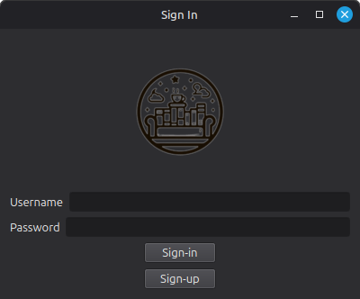 | 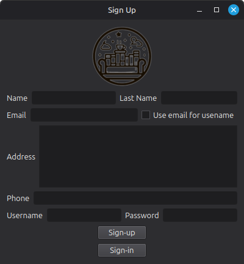 |

### 2. Main Dashboards (Customer vs. Admin)
| Customer Dashboard | Admin Dashboard |
| :---: | :---: |
| 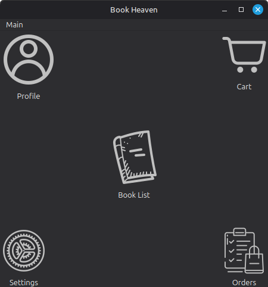 | 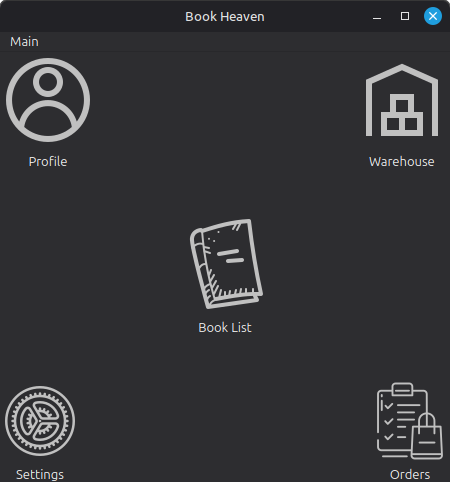 |

### 3. Catalog & Inventory
| Customer Book Catalog | Admin Book Management |
| :---: | :---: |
| 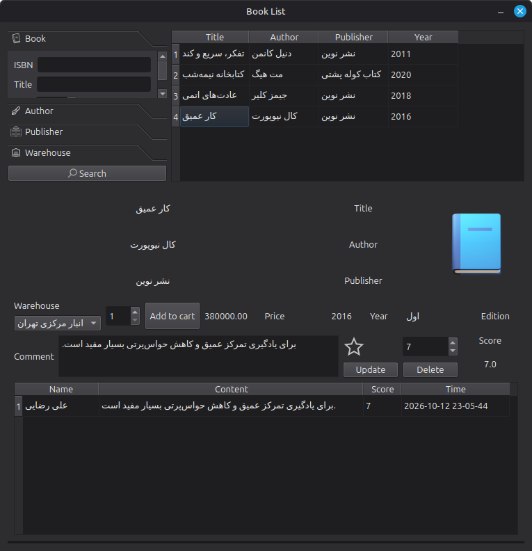 | 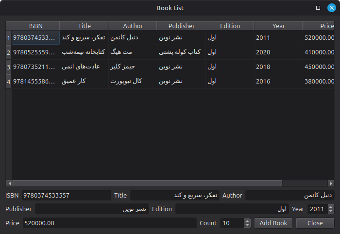 |

### 4. Orders & Warehouse Stock
| Customer Orders History | Admin Warehouse Inventory |
| :---: | :---: |
| 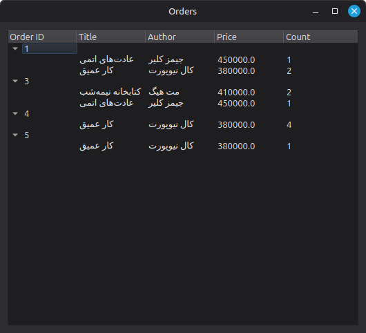 | 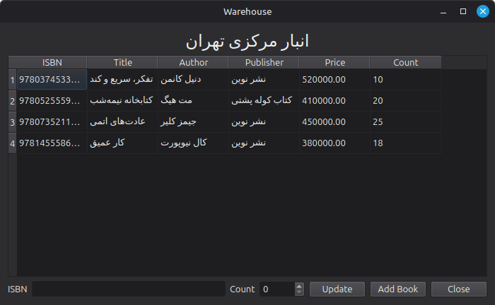 |

### 5. User Profiles
| Customer Profile | Admin Profile |
| :---: | :---: |
| 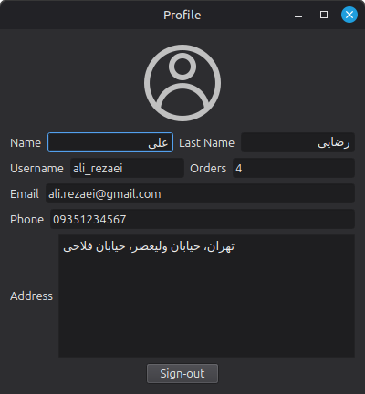 | 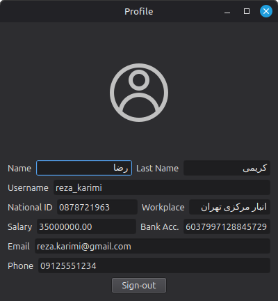 |

### 6. Preferences & Themes
| Application Settings (Dark / Light Theme) |
| :---: |
| 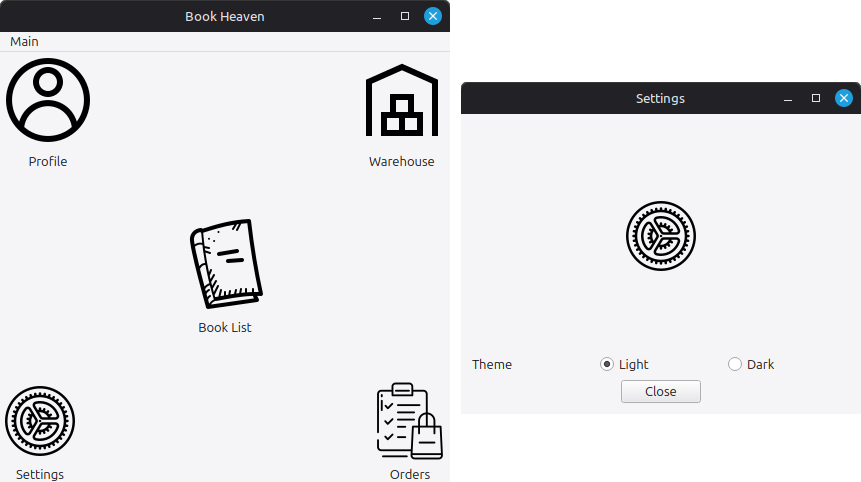 |

---

## ⚡ Quick Start

### 1. Setup Environment
```bash
# Clone repository
git clone https://github.com/galaxy248/book-heaven.git
cd book-heaven

# Create and activate virtual environment
python3 -m venv .venv
source .venv/bin/activate       # Windows: .venv\Scripts\activate

# Install dependencies
pip install -r requirements.txt
cp .env.example .env
```

### 2. Start PostgreSQL (Docker)
```bash
docker compose up -d
```


### 3. Launch Backend & Desktop App
```bash
# Terminal 1 - Backend API (http://127.0.0.1:8080)
python flask/app.py

# Terminal 2 - Desktop Client
python gui/app.py
```

---

## 🔑 Demo Accounts

| Role | Username | Password |
| :--- | :--- | :---: |
| **Customer** | `ali_rezaei` | `1234` |
| **Customer** | `sara_mohammadi` | `1234` |
| **Admin** | `reza_karimi` | `1234` |

---

## 📂 Project Structure

```text
db/
├── docker/            # PostgreSQL initialization script (init.sql)
├── docker-compose.yml # PostgreSQL 16 container definition
├── flask/             # Flask REST API backend & token authentication
├── gui/               # PyQt6 desktop application (UI files, themes, controllers)
│   ├── UI/            # Qt Designer .ui forms & theme-adaptive icons
│   ├── settings/      # Local user session & token cache (git-ignored)
│   └── tmp/           # Shopping cart cache (git-ignored)
├── screenshots/       # Application screenshots
├── requirements.txt   # Python package dependencies
└── README.md
```

---

## 👥 Authors

* **Sina Jani**
* **Arman Heidari**
* **Amir Mohammad Anvari**

---

## 📄 License
This project is open-source under the [MIT License](LICENSE).
